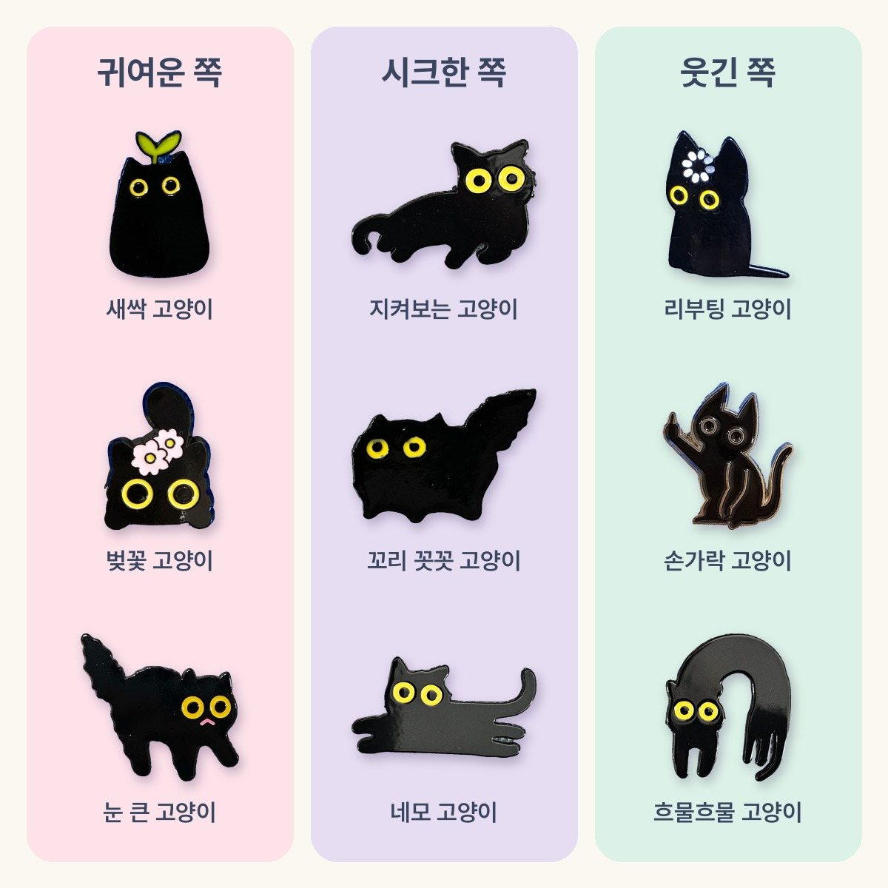

토크모스토어에는 검은 고양이 배지가 꽤 많아요. 하나씩 늘어놓고 보니 같은 까만 고양이인데 표정이 다 달라서, 귀여운 쪽, 시크한 쪽, 웃긴 쪽으로 나눠 봤어요.

배지를 누르시면 토크모스토어 상품 페이지로 연결됩니다.

## 먼저, 귀여운 아이들

새싹 고양이는 머리 위에 초록 잎이 하나 돋아 있어요. 귀여운 쪽에서는 이 친구가 제일 많이 나가요.

벚꽃을 얹은 고양이, 눈이 동그랗게 큰 고양이도 같은 분위기예요. 누구에게 건네도 부담 없는 얼굴들이에요.





## 조용히 멋있는 고양이

노란 눈으로 가만히 이쪽을 쳐다보는 고양이는 볼수록 묘해요.

꼬리를 바짝 세운 고양이도 있고, 몸이 아예 네모난 고양이도 있어요. 네모 고양이는 처음엔 웃긴데, 자꾸 보면 은근히 세련돼 보여요.





## 보기만 해도 웃음 나는 쪽

멍하니 화면을 보고 있는 리부팅 고양이가 검은 고양이 배지 중 1등이에요.

2등은 가운데 손가락을 든 고양이예요. 좀 과감하긴 한데, 친한 친구끼리 주고받기엔 이만한 게 없더라고요.

흐물흐물 녹아내린 고양이는 '고양이는 액체'라는 말을 그대로 옮겨 놓은 것 같아요.





검은 고양이 배지는 이 밖에도 더 있어요. 쇼핑몰 고양이 카테고리에서 전부 보실 수 있어요.
