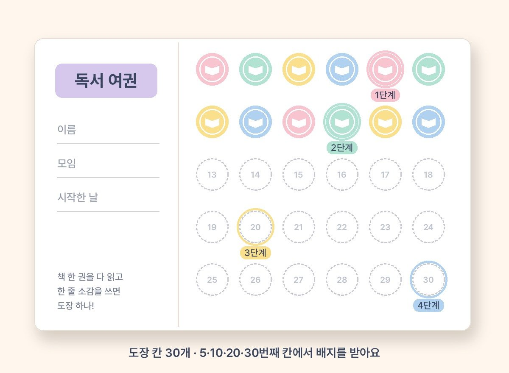
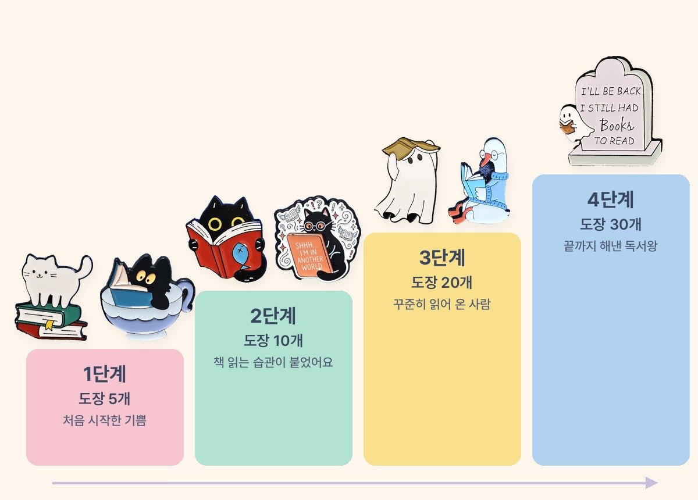

## 책 읽기를 오래 이어 가는 작은 장치

독서 활동은 시작할 때는 다들 열심이지만, 몇 주가 지나면 힘이 빠지기 쉽습니다.
이럴 때 눈에 보이는 기록과 작은 보상이 있으면 끝까지 이어 가는 힘이 됩니다.
여권처럼 도장을 모으는 '독서 여권'과, 단계마다 받는 배지를 함께 써 보시면 좋습니다.

## 독서 여권은 이렇게 만드시면 됩니다

- 작은 수첩이나 접는 종이 한 장이면 충분합니다.
- 앞면에는 이름과 '독서 여권'을, 안쪽에는 도장 칸을 30개쯤 그려 두시면 됩니다.
- 책 한 권을 다 읽고 한 줄 소감을 쓰면 도장 하나를 찍어 주세요.
- 도장 대신 스티커를 쓰셔도 됩니다.

## 도장이 모이면 배지로 보상합니다

> 5개 · 10개 · 20개 · 30개

- 1단계(도장 5개): 처음 시작한 기쁨을 담은 배지
- 2단계(도장 10개): 책 읽는 습관이 붙었다는 표시
- 3단계(도장 20개): 꾸준히 읽어 온 사람에게 주는 배지
- 4단계(도장 30개): 끝까지 해낸 독서왕 배지

단계가 올라갈수록 배지가 달라지면, 다음 단계를 기다리는 재미가 생깁니다.
받은 배지는 가방이나 필통, 이름표에 달아 두면 서로 자랑하는 계기가 됩니다.

## 단계에 맞는 독서 배지

배지를 누르시면 토크모스토어 상품 페이지로 연결됩니다.

**1단계 · 도장 5개**




**2단계 · 도장 10개**




**3단계 · 도장 20개**




**4단계 · 도장 30개**



## 준비하실 때 알아 두시면 좋은 점

- 인원보다 넉넉히 준비하시면 중간에 들어오는 사람도 함께하실 수 있습니다.
- 단계마다 배지를 한 가지로 정해 두시면 '그 배지 = 그 단계'로 기억에 남습니다.
- 마지막 단계 배지는 한 가지만 두면 더 특별하게 느껴집니다.

## 마무리

책 한 권마다 찍는 도장, 단계마다 받는 배지 하나가 독서를 끝까지 이어 가게 해 줍니다.
선생님께서 이끄시는 독서 활동에 작은 재미를 더해 보세요.
