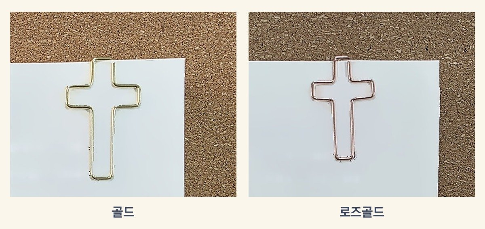

새 성경책은 한동안 아껴 가며 펼치게 돼요. 읽기 시작하면 어디까지 읽었는지 표시해 둘 것이 필요해지고요.

## 읽던 자리에 끼워 두는 클립

십자가 모양 클립이에요. 골드와 로즈골드 두 색이 있고, 모양은 같아요.

한 통에 15개가 들어 있어요. 성경책에 하나 끼우고도 많이 남아서, 묵상 노트가 한 권 더 생기거나 함께 성경 공부하는 사람들과 나눌 때도 그대로 쓸 수 있는 양이에요.

## 작은 선물이 필요할 때

교회에 처음 나온 친구나 세례를 받은 사람에게 작은 마음을 전하고 싶을 때가 있어요.

파도 위로 십자가가 떠오르는 둥근 배지에는 '걱정하지 마, 하나님이 함께하셔'라는 말이 영어로 적혀 있어요. 새로 시작하는 사람에게 해 주고 싶은 그 말을 배지에 담아 건넬 수 있어요.

말보다 모양으로 보여 주고 싶다면, 글자 없이 금색 십자가만 있는 미니 메탈 배지도 있어요.

배지를 누르시면 토크모스토어 상품 페이지로 연결됩니다.





