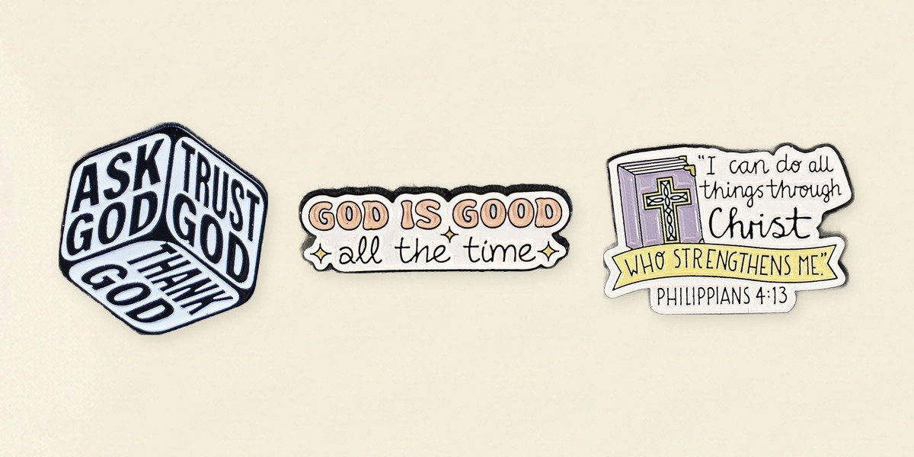

교회학교(주일학교)에는 주일마다 일찍 나와 공과를 준비하고 아이들을 맞이하는 선생님들이 계십니다. 반을 맡지는 않아도 간식을 챙기고 예배 자리를 정리하는 봉사자분들도 함께 섬기고 계십니다.

교사 모임이나 교육부서 행사 때 이분들께 작은 선물로 고마움을 전하기도 합니다. 여러 분께 드리는 선물이라 대개 같은 것으로 준비하게 됩니다.

## 말씀 한 줄이 적힌 배지

세 배지 모두 짧은 영어 문구가 적혀 있습니다.

주사위 모양 배지의 세 면에는 ASK GOD, TRUST GOD, THANK GOD이 하나씩 들어 있습니다. 구하고, 의지하고, 감사하라는 세 마디는 "구하라 그리하면 너희에게 주실 것이요"(마태복음 7장 7절), "범사에 감사하라"(데살로니가전서 5장 18절) 같은 말씀과 이어집니다.

GOD IS GOOD all the time은 '하나님은 언제나 선하시다'라는 고백입니다. 시편 136편은 "여호와께 감사하라 그는 선하시며 그 인자하심이 영원함이로다"로 시작합니다.

빌립보서 4장 13절 배지에는 펼친 성경 그림과 함께 "I can do all things through Christ who strengthens me"가 적혀 있습니다. 개역개정으로는 "내게 능력 주시는 자 안에서 내가 모든 것을 할 수 있느니라"입니다. 바로 앞 절에서 바울은 배부름과 배고픔, 풍부와 궁핍 어느 쪽에도 처할 줄 아는 비결을 배웠다고 말합니다. 형편이 어떻든 맡은 반을 지켜 온 선생님께는 이 앞뒤 흐름까지 함께 읽히는 구절입니다.

## 열두 분께 열두 가지 말씀

자석 책갈피는 한 세트에 서로 다른 말씀 열두 가지가 들어 있어, 열두 분께 하나씩 나눠 드릴 수 있습니다. 구절마다 짧고 글씨가 커서 한눈에 들어옵니다.

"The LORD bless you and protect you"는 민수기 6장 24절 "여호와는 네게 복을 주시고 너를 지키시기를 원하며"입니다. 아론의 축복 기도로 알려진 말씀의 첫머리입니다.

"The greatest of these is love"는 고린도전서 13장 13절 "그 중의 제일은 사랑이라"이고, "God is love"는 요한일서 4장 8절의 "하나님은 사랑이심이라"입니다.

종이를 사이에 두고 앞뒤가 자석으로 붙는 책갈피라, 성경책이나 공과 교재를 덮어도 끼운 자리에 그대로 붙어 있습니다.

주일마다 아이들에게 말씀을 가르쳐 주시는 선생님들께, 고마운 마음도 말씀 한 줄에 담아 전해 보세요.

배지를 누르시면 토크모스토어 상품 페이지로 연결됩니다.





